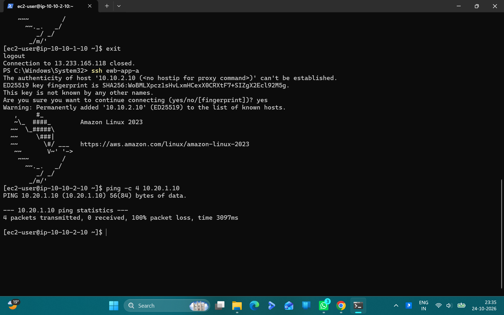

\# AWS Multi-VPC Peering \& Bastion ProxyJump Architecture

\## Overview \& Objectives

This project implements and validates a secure, multi-VPC network architecture on Amazon Web Services (AWS) in the `ap-south-1` (Mumbai) region:

\- Isolated VPCs (`ewb-vpc-a` and `ewb-vpc-b`) with non-overlapping private CIDR blocks.

\- Non-transitive private inter-VPC connectivity via AWS VPC Peering (`ewb-pcx-a-b`).

\- Secure perimeter ingress via an Amazon Linux 2023 Bastion Host using OpenSSH `ProxyJump` (no public IPs assigned to backend instances).

\- Systematic connectivity validation: baseline failure, route convergence, security group debugging, and bidirectional ICMP ping testing.

\---

\## Architecture \& Subnet Layout

| Resource | CIDR / Type | Subnet / Placement | Role |

| :--- | :--- | :--- | :--- |

| \*\*ewb-vpc-a\*\* | `10.10.0.0/16` | Region `ap-south-1` | Primary VPC |

| \*\*ewb-vpc-b\*\* | `10.20.0.0/16` | Region `ap-south-1` | Secondary isolated VPC |

| \*\*ewb-a-public\*\* | `10.10.1.0/24` | `ewb-vpc-a` | Bastion Jump Host tier |

| \*\*ewb-a-private\*\* | `10.10.2.0/24` | `ewb-vpc-a` | Private App-A instance |

| \*\*ewb-b-private\*\* | `10.20.1.0/24` | `ewb-vpc-b` | Private App-B instance |

| \*\*ewb-pcx-a-b\*\* | VPC Peering | Cross-VPC | Dedicated private peering link |

\---

\## Route Tables

1\. \*\*ewb-rt-a-private\*\*:

&#x20;  - `10.20.0.0/16` -> `ewb-pcx-a-b`

2\. \*\*ewb-rt-a-public\*\*:

&#x20;  - `0.0.0.0/0` -> `ewb-igw-a`

&#x20;  - `10.20.0.0/16` -> `ewb-pcx-a-b`

3\. \*\*ewb-rt-b-private\*\*:

&#x20;  - `10.10.0.0/16` -> `ewb-pcx-a-b`

\---

\## Empirical Verification Matrix

| Test | Flow | Expected Result | Observed Result | Status |

| :--- | :--- | :--- | :--- | :--- |

| \*\*Test 01\*\* | App-A -> App-B | 100% Packet Loss (Pre-peering) | 100% packet loss | \*\*PASS\*\* |

| \*\*Test 02\*\* | App-A -> App-B | 0% Packet Loss (Post-peering) | 0% packet loss (\~0.21 ms) | \*\*PASS\*\* |

| \*\*Test 03\*\* | App-B -> App-A | 0% Packet Loss (Bidirectional) | 0% packet loss (\~0.20 ms) | \*\*PASS\*\* |

\### Troubleshooting Case: Security Group Ingress Policy

During initial reverse testing (`App-B -> App-A`), ICMP echo requests timed out with 100% packet loss despite valid route table entries. Inspection revealed that `ewb-sg-app-a` was missing an explicit inbound rule for ICMP traffic from `10.20.0.0/16`. Once an inbound rule allowing \*\*All ICMP - IPv4\*\* was applied to the security group, bidirectional ping resolved with 0% packet loss.

\---

\## Cleanup \& Teardown

All infrastructure components were systematically destroyed to avoid recurring costs:

1\. Terminated all EC2 instances (`ewb-bastion`, `ewb-app-a`, `ewb-app-b`).

2\. Deleted VPC Peering Connection (`ewb-pcx-a-b`).

3\. Detached and removed Internet Gateway (`ewb-igw-a`).

4\. Deleted VPCs (`ewb-vpc-a`, `ewb-vpc-b`) and associated subnets/security groups.

5\.

